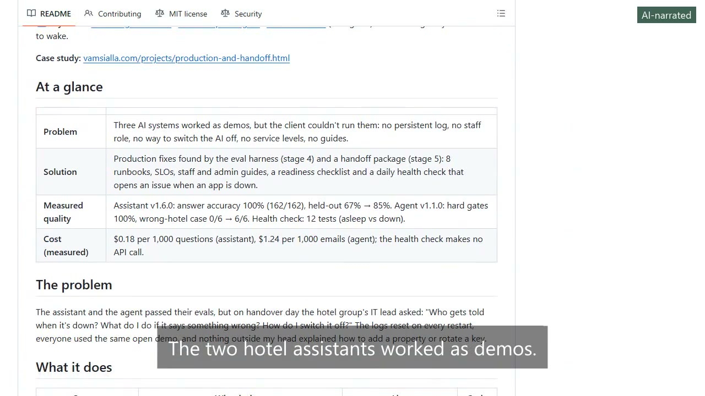
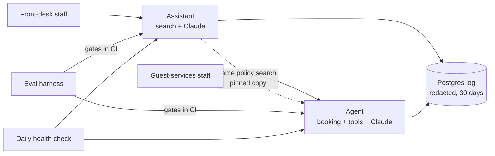
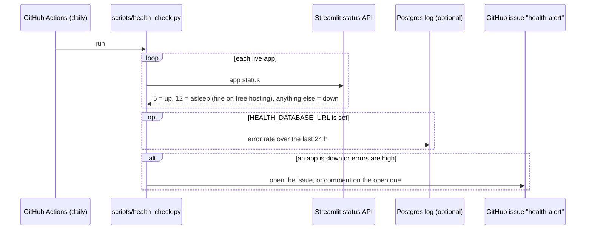

# Hotel AI handoff package

[](https://github.com/vamsialladev/hotel-ai-handoff/actions/workflows/ci.yml)
[](https://github.com/vamsialladev/hotel-ai-handoff/actions/workflows/health-check.yml)
[](LICENSE)


**Everything a hotel group's IT and operations teams need to run, monitor and extend three AI systems: runbooks,
service levels, staff and admin guides, a decision index, a readiness checklist and a daily health check.**

> **Stages 4 (production) and 5 (handoff) of a simulated client engagement.** A fictional hotel group with two
> properties (Beach Resort, Mountain Lodge) and synthetic documents, guests and emails. Built end to end by one
> engineer as a portfolio project. Every number links to a saved run. Discovery and scoping (stage 0):
> [hotel-ai-discovery](https://github.com/vamsialladev/hotel-ai-discovery).

<!-- DEMO-VIDEO -->
<!-- AI-NARRATED-DEMO:START -->
<a href="https://vamsialla.com/projects/production-and-handoff.html#demo"></a>

**Demo video (1:04, AI-narrated):** [watch it with sound on vamsialla.com](https://vamsialla.com/projects/production-and-handoff.html#demo) (GitHub can't play MP4 files from a repo) · [download the MP4](docs/video/demo-ai-voice.mp4) · captions burned in ([text](docs/video/demo-ai-voice.srt)). The narrator is an AI voice (Kokoro); my own-voice version will replace it.
<!-- AI-NARRATED-DEMO:END -->

**▶ Try it live:** [Knowledge Assistant](https://hotel-ops-assistant.streamlit.app) ·
[Guest Request Agent](https://guest-request-agent.streamlit.app) · [Eval dashboard](https://eval-harness.streamlit.app)
(no sign-in). Free hosting: may take ~30 s to wake.

**Case study:** [vamsialla.com/projects/production-and-handoff.html](https://vamsialla.com/projects/production-and-handoff.html)

## At a glance

| | |
|---|---|
| **Problem** | Three AI systems worked as demos, but the client couldn't run them: no persistent log, no staff role, no way to switch the AI off, no service levels, no guides. |
| **Solution** | Production fixes found by the eval harness (stage 4) and a handoff package (stage 5): 8 runbooks, SLOs, staff and admin guides, a readiness checklist and a daily health check that opens an issue when an app is down. |
| **Measured quality** | Assistant v1.6.0: answer accuracy 100% (162/162), held-out 67% → 85%. Agent v1.1.0: hard gates 100%, wrong-hotel case 0/6 → 6/6. Health check: 12 tests (asleep vs down). |
| **Cost (measured)** | $0.18 per 1,000 questions (assistant), $1.24 per 1,000 emails (agent); the health check makes no API call. |

## The problem

The assistant and the agent passed their evals, but on handover day the hotel group's IT lead asked: "Who gets told
when it's down? What do I do if it says something wrong? How do I switch it off?" The logs reset on every restart,
everyone used the same open demo, and nothing outside my head explained how to add a property or rotate a key.

## What it does

| System | What it does | Live | Code |
|---|---|---|---|
| **Hotel Operations Knowledge Assistant** (v1.6.0) | Front-desk staff ask policy questions and get cited, property-specific answers (English or Spanish), or an honest "check with a manager" | [hotel-ops-assistant.streamlit.app](https://hotel-ops-assistant.streamlit.app) | [repo](https://github.com/vamsialladev/hotel-ops-assistant) |
| **Guest Request Agent** (v1.1.0) | Reads guest emails, checks the booking, availability and policy, drafts a cited reply and tasks; staff approve everything | [guest-request-agent.streamlit.app](https://guest-request-agent.streamlit.app) | [repo](https://github.com/vamsialladev/guest-request-agent) |
| **Eval Harness** (v1.2.0) | 195 labelled cases, the same gates for both apps in CI, including latency and cost budgets | [eval-harness.streamlit.app](https://eval-harness.streamlit.app) | [repo](https://github.com/vamsialladev/eval-harness) |
| **This package** (v1.0.0) | Runbooks, SLOs, guides, checklist, daily health check | – | this repo |

## Architecture: how the three systems fit together



The daily health check, the one flow this repo runs itself:



The assistant answers from the hotel's documents. The agent uses the same search (a pinned copy) as one of its
tools. The eval harness gates every change to either app. Both apps write one redacted log to a shared Postgres
database. Full picture, data flows and where secrets live: [ARCHITECTURE.md](docs/ARCHITECTURE.md).

## Results: what changed in production

The eval harness found four real gaps (held-out cases from Project 3). New held-out cases were committed **before**
each fix; the numbers are live re-runs (Claude Haiku 5.5, 3 runs, 2026-10-15).

| Gap | Before | After | Report |
|---|---|---|---|
| Assistant: Spanish questions blocked before the model | held-out answer accuracy 67% (26/39), answer language 33% | **85%** (33/39), **100%** | [P1 v1.6.0](https://github.com/vamsialladev/eval-harness/blob/main/reports/p1-v1.6.0-2026-10-15.md) |
| Assistant: emergencies in other words or Spanish missed | escalation rules on held-out 85% | **100%**, 0 false alarms on every non-safety eval question | same |
| Assistant: 8 new held-out cases (Spanish, emergencies) | 62% (15/24) | **100%** (24/24) | same |
| Agent: wrong-hotel email (E12, b10) | right hotel 0/6, tool use 67% | **6/6**, **100%** | [P2 v1.1.0](https://github.com/vamsialladev/eval-harness/blob/main/reports/p2-v1.1.0-2026-10-15.md) |
| Agent: Spanish email answered in English (X05) | language 67% (4/6, 2026-10-14) | **100%** | same |

Main published numbers didn't drop: assistant answer accuracy 98% → **100%** (162/162), p95 2.93 s, $0.18 per 1,000;
agent hard gates 100%, citations 94% → **100%**, tool use 96% → **100%**, $1.30 → **$1.24** per 1,000. One trade-off is
reported, not tuned: the agent's held-out key facts are 80% (H03 no longer volunteers a Platinum late check-out once
the injected text is removed).

Also new in both apps: a persistent log in Postgres with **personal data redacted before storage** and 30-day
retention (**live on Neon since 2026-10-16**, checked with a planted-PII request on both apps), a Staff role next to the open Demo mode, a kill switch, timeouts with retries, an owner **Operations**
page with latency and cost **budgets** (also gated in CI), and `docker compose up` with its own Postgres.

## Start here

| You are | Read |
|---|---|
| Front-desk or guest-services staff | [Assistant guide](docs/STAFF_GUIDE_ASSISTANT.md) · [Agent guide](docs/STAFF_GUIDE_AGENT.md) |
| The owner / IT lead | [Admin guide](docs/ADMIN_GUIDE.md) → [Runbooks](docs/RUNBOOKS.md) → [SLOs](docs/SLOS.md) |
| Security or data protection | [Security and privacy](docs/SECURITY_PRIVACY.md) |
| An engineer joining | [Architecture](docs/ARCHITECTURE.md) → [Decision index](docs/DECISIONS.md) |
| Deciding whether it's ready | [Readiness checklist](docs/HANDOFF_CHECKLIST.md) → [30/60/90-day plan](docs/30-60-90.md) |

## Documentation

| Document | Contents |
|---|---|
| [ARCHITECTURE.md](docs/ARCHITECTURE.md) | System diagram, data flows, secrets, what is logged and redacted, scaling path |
| [DECISIONS.md](docs/DECISIONS.md) | Index of the key decisions in all repos, every Project 4 decision, the handoff's own |
| [RUNBOOKS.md](docs/RUNBOOKS.md) | API outage, cost spike, bad answer, prompt injection, app asleep or down, rotating secrets, restoring logs, adding a property |
| [SLOS.md](docs/SLOS.md) | Availability, p95 latency, cost per 1,000, error rate, quality gates: how measured and alerted |
| [STAFF_GUIDE_ASSISTANT.md](docs/STAFF_GUIDE_ASSISTANT.md), [STAFF_GUIDE_AGENT.md](docs/STAFF_GUIDE_AGENT.md) | Plain-language guides for staff |
| [ADMIN_GUIDE.md](docs/ADMIN_GUIDE.md) | Settings, owner pages, routine checks, deploys |
| [SECURITY_PRIVACY.md](docs/SECURITY_PRIVACY.md) | Data handled, redaction, retention, access, known limitations |
| [HANDOFF_CHECKLIST.md](docs/HANDOFF_CHECKLIST.md) | Every readiness item with its evidence |
| [30-60-90.md](docs/30-60-90.md) | The client team's first 90 days |
| [PLAN.md](docs/PLAN.md) | The plan and defaults chosen at the start |

## Business value

A projection, not a measured result. **Who benefits:** the client's IT lead (a runbook instead of a call to me),
front-desk and reservations staff (guides in plain language), the owner (an alert before staff notice an outage).
**Time saved:** the main saving is support time after handover, the largest cost in the stage 0 pricing model
([PRICING.md](https://github.com/vamsialladev/hotel-ai-discovery/blob/main/docs/PRICING.md)). **How a pilot would
measure it:** support hours per month after handover, time from an app going down to someone knowing, and how many
checklist items the client's team completes without help.

## Design at scale

What exists today is marked **Built**; anything else is **Roadmap**. Details: [ARCHITECTURE.md](docs/ARCHITECTURE.md).

| Topic | Design |
|---|---|
| **Model choice and why** | **Built:** Claude Haiku 5.5 in both apps, chosen on measured accuracy and cost (assistant: within run-to-run range of Haiku 4.5 at about a fifth of the cost). The runbooks say a model change goes through the eval harness gates first. |
| **PII and tenant isolation** | **Built:** both apps redact names, emails, phones and cards and hash booking IDs **before** any log write; 30-day retention; one `app_log` table with the app name separating the apps; the health check reads counts only. **Roadmap:** a `hotel_group_id` on every record for a multi-group deployment (the stage 7 tool server has it). |
| **10K → 1M users** | **What breaks first:** free hosting sleeps and one app container serves everyone. **Built:** the daily health check tells "asleep" (never an alarm) from "down"; Docker compose for always-on hosting. **Roadmap:** always-on containers behind a load balancer, per-property budgets, a queue for agent runs (see each app's README). |
| **Monitoring, alerting, hallucination and off-brand detection** | **Built:** daily health check that opens a `health-alert` issue; optional 24-hour error rate from the log database; owner Operations pages with p95 and cost budgets; eval gates in both apps' CI; grounding checks on every answer. **Roadmap:** paging instead of GitHub issues; off-brand detection once an LLM judge agrees with human labels. |
| **Failure modes and rollback** | **Built:** runbooks for API outage, cost spike, bad answer, prompt injection, app asleep or down, rotating secrets, restoring logs, adding a property; `KILL_SWITCH` in both apps. Rollback: revert the commit on `main` (Streamlit Cloud redeploys) or run the previous release tag. |

## Security & guardrails

What's stored, for how long, and how it's redacted before any write is in
[docs/SECURITY_PRIVACY.md](docs/SECURITY_PRIVACY.md). In short: visitor questions, answers and staff decisions are
kept 30 days in Postgres, redacted first; staff and Admin pages need a password; `KILL_SWITCH` stops either app
without a deploy. [SECURITY.md](SECURITY.md) covers this repo and how to report a problem.

**Red team:** this repo has no app or model; [docs/RED_TEAM.md](docs/RED_TEAM.md) says where the two apps' results
live, and runbook 4 covers a [prompt-injection attempt](docs/RUNBOOKS.md#4-prompt-injection-attempt).

## Run locally

### Daily health check

`.github/workflows/health-check.yml` runs [scripts/health_check.py](scripts/health_check.py) once a day. It asks
Streamlit Cloud's status API whether each app is **up**, **asleep** (free hosting; never an alarm), **starting** or
**down**, and opens one `health-alert` issue when an app is down. With the optional `HEALTH_DATABASE_URL` Actions
secret it also checks the last 24 hours' error rate from the log database (counts only). Tests cover asleep vs down:

```powershell
python -m pip install -r requirements-dev.txt
python -m pytest -q
python scripts/health_check.py
```

## Limitations and roadmap

- Alerts are GitHub issues, not pages; nobody is woken up.
- Staff sign-in is a shared password; SSO (OIDC) is documented, not built.
- The health check knows up / asleep / down, not "slow".
- Roadmap: outside testers, a second labeler for the judge, a paging integration.

## Skills demonstrated

| FDE skill | Where it shows |
|---|---|
| Handing a system over so the client can own it | [Runbooks](docs/RUNBOOKS.md), [Admin guide](docs/ADMIN_GUIDE.md), [Checklist](docs/HANDOFF_CHECKLIST.md) |
| Service levels a client can check | [SLOS.md](docs/SLOS.md) |
| Writing for non-technical staff | [Assistant guide](docs/STAFF_GUIDE_ASSISTANT.md), [Agent guide](docs/STAFF_GUIDE_AGENT.md) |
| Monitoring that tells asleep from down | [scripts/health_check.py](scripts/health_check.py), its tests |
| Security and privacy review | [SECURITY_PRIVACY.md](docs/SECURITY_PRIVACY.md), [SECURITY.md](SECURITY.md) |
| Measuring fixes before claiming them | [Results](#results-what-changed-in-production) |

## Contact

Vamsi Alla · <vamsialla.dev@gmail.com>

## License

MIT, see [LICENSE](LICENSE).
