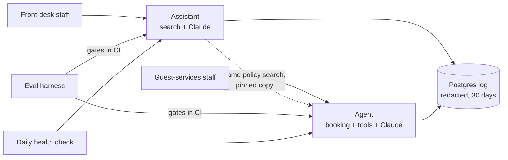

# Hotel AI handoff package

[](https://github.com/vamsialladev/hotel-ai-handoff/actions/workflows/ci.yml)
[](https://github.com/vamsialladev/hotel-ai-handoff/actions/workflows/health-check.yml)
[](LICENSE)

Everything a hotel group's IT and operations teams need to run, monitor and extend three AI systems: runbooks, service
levels, staff and admin guides, a decision index, a readiness checklist and a daily health check.

> **Simulated client engagement.** A fictional hotel group with two properties (Beach Resort, Mountain Lodge) and
> synthetic documents, guests and emails. Built end to end by one engineer as a portfolio project. Every number links
> to a saved run.

**Case study:** [vamsialla.com/projects/production-and-handoff.html](https://vamsialla.com/projects/production-and-handoff.html)

## What was delivered

| System | What it does | Live | Code |
|---|---|---|---|
| **Hotel Operations Knowledge Assistant** (v1.6.0) | Front-desk staff ask policy questions and get cited, property-specific answers (English or Spanish), or an honest "check with a manager" | [hotel-ops-assistant.streamlit.app](https://hotel-ops-assistant.streamlit.app) | [repo](https://github.com/vamsialladev/hotel-ops-assistant) |
| **Guest Request Agent** (v1.1.0) | Reads guest emails, checks the booking, availability and policy, drafts a cited reply and tasks; staff approve everything | [guest-request-agent.streamlit.app](https://guest-request-agent.streamlit.app) | [repo](https://github.com/vamsialladev/guest-request-agent) |
| **Eval Harness** (v1.2.0) | 195 labelled cases, the same gates for both apps in CI, including latency and cost budgets | [eval-harness.streamlit.app](https://eval-harness.streamlit.app) | [repo](https://github.com/vamsialladev/eval-harness) |
| **This package** (v1.0.0) | Runbooks, SLOs, guides, checklist, daily health check | – | this repo |

Free hosting: if an app says it is asleep, click **Yes, get this app back up** and give it about a minute.

## How the three systems fit together



The assistant answers from the hotel's documents. The agent uses the same search (a pinned copy) as one of its
tools. The eval harness gates every change to either app. Both apps write one redacted log to a shared Postgres
database. Full picture, data flows and where secrets live: [ARCHITECTURE.md](docs/ARCHITECTURE.md).

## What changed in production

The eval harness found four real gaps (held-out cases from Project 3). New held-out cases were committed **before**
each fix; the numbers are live re-runs (Claude Haiku 5.5, 3 runs, 2026-10-15).

| Gap | Before | After | Report |
|---|---|---|---|
| Assistant: Spanish questions blocked before the model | held-out answer accuracy 67% (26/39), answer language 33% | **85%** (33/39), **100%** | [P1 v1.6.0](https://github.com/vamsialladev/eval-harness/blob/main/reports/p1-v1.6.0-2026-10-15.md) |
| Assistant: emergencies in other words or Spanish missed | escalation rules on held-out 85% | **100%**, 0 false alarms on every non-safety eval question | same |
| Assistant: 8 new held-out cases (Spanish, emergencies) | 62% (15/24) | **100%** (24/24) | same |
| Agent: wrong-hotel email (E12, b10) | right hotel 0/6, tool use 67% | **6/6**, **100%** | [P2 v1.1.0](https://github.com/vamsialladev/eval-harness/blob/main/reports/p2-v1.1.0-2026-10-15.md) |
| Agent: Spanish email answered in English (X05) | language 67% (4/6, 2026-10-14) | **100%** | same |

Main published numbers didn't drop: assistant answer accuracy 98% → **100%** (162/162), p95 2.93 s, $0.18 per 1,000;
agent hard gates 100%, citations 94% → **100%**, tool use 96% → **100%**, $1.30 → **$1.24** per 1,000. One trade-off is
reported, not tuned: the agent's held-out key facts are 80% (H03 no longer volunteers a Platinum late check-out once
the injected text is removed).

Also new in both apps: a persistent log in Postgres with **personal data redacted before storage** and 30-day
retention (**live on Neon since 2026-10-16**, checked with a planted-PII request on both apps), a Staff role next to the open Demo mode, a kill switch, timeouts with retries, an owner **Operations**
page with latency and cost **budgets** (also gated in CI), and `docker compose up` with its own Postgres.

## Start here

| You are | Read |
|---|---|
| Front-desk or guest-services staff | [Assistant guide](docs/STAFF_GUIDE_ASSISTANT.md) · [Agent guide](docs/STAFF_GUIDE_AGENT.md) |
| The owner / IT lead | [Admin guide](docs/ADMIN_GUIDE.md) → [Runbooks](docs/RUNBOOKS.md) → [SLOs](docs/SLOS.md) |
| Security or data protection | [Security and privacy](docs/SECURITY_PRIVACY.md) |
| An engineer joining | [Architecture](docs/ARCHITECTURE.md) → [Decision index](docs/DECISIONS.md) |
| Deciding whether it's ready | [Readiness checklist](docs/HANDOFF_CHECKLIST.md) → [30/60/90-day plan](docs/30-60-90.md) |

## Documentation

| Document | Contents |
|---|---|
| [ARCHITECTURE.md](docs/ARCHITECTURE.md) | System diagram, data flows, secrets, what is logged and redacted, scaling path |
| [DECISIONS.md](docs/DECISIONS.md) | Index of the key decisions in all repos, every Project 4 decision, the handoff's own |
| [RUNBOOKS.md](docs/RUNBOOKS.md) | API outage, cost spike, bad answer, prompt injection, app asleep or down, rotating secrets, restoring logs, adding a property |
| [SLOS.md](docs/SLOS.md) | Availability, p95 latency, cost per 1,000, error rate, quality gates: how measured and alerted |
| [STAFF_GUIDE_ASSISTANT.md](docs/STAFF_GUIDE_ASSISTANT.md), [STAFF_GUIDE_AGENT.md](docs/STAFF_GUIDE_AGENT.md) | Plain-language guides for staff |
| [ADMIN_GUIDE.md](docs/ADMIN_GUIDE.md) | Settings, owner pages, routine checks, deploys |
| [SECURITY_PRIVACY.md](docs/SECURITY_PRIVACY.md) | Data handled, redaction, retention, access, known limitations |
| [HANDOFF_CHECKLIST.md](docs/HANDOFF_CHECKLIST.md) | Every readiness item with its evidence |
| [30-60-90.md](docs/30-60-90.md) | The client team's first 90 days |
| [PLAN.md](docs/PLAN.md) | The plan and defaults chosen at the start |

## Daily health check

`.github/workflows/health-check.yml` runs [scripts/health_check.py](scripts/health_check.py) once a day. It asks
Streamlit Cloud's status API whether each app is **up**, **asleep** (free hosting; never an alarm), **starting** or
**down**, and opens one `health-alert` issue when an app is down. With the optional `HEALTH_DATABASE_URL` Actions
secret it also checks the last 24 hours' error rate from the log database (counts only). Tests cover asleep vs down:

```powershell
python -m pip install -r requirements-dev.txt
python -m pytest -q
python scripts/health_check.py
```

## Contact

Vamsi Alla · <vamsialla.dev@gmail.com>

## License

MIT, see [LICENSE](LICENSE).
