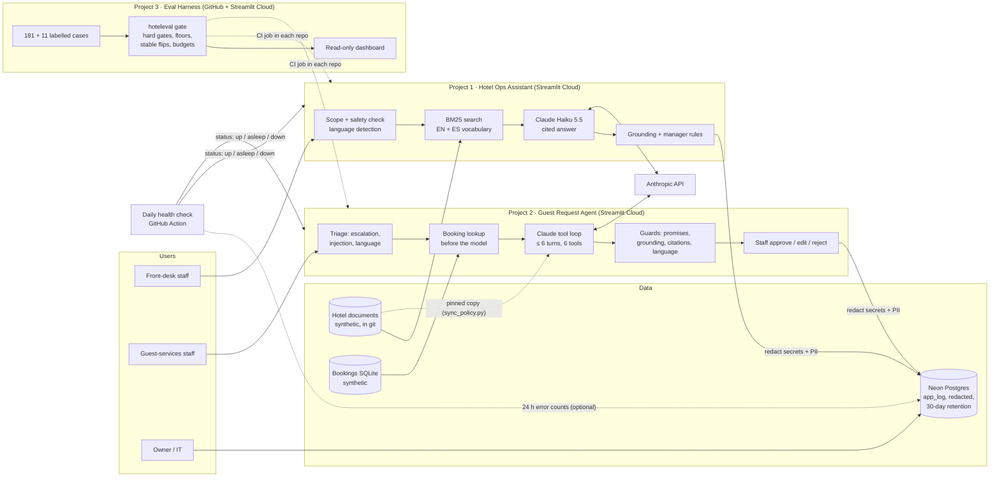

# Architecture

Three systems built for one simulated hotel group (two properties, `beach-resort` and `mountain-lodge`, plus
brand-wide documents), with synthetic data throughout.

## System diagram

## Data flows

| Flow | Path | Notes |
|---|---|---|
| Staff question | browser → assistant → scope/safety check → search → Claude → checks → screen | emergencies and off-topic questions stop before Claude (no API call) |
| Guest email | browser → agent → triage → booking lookup (sender's address only) → Claude tool loop → guards → staff | nothing is ever sent; money/exceptions go to a manager queue |
| Request log | app → `usage.redact` (secrets) → `pii.redact_record` (personal data) → Postgres `app_log` | fallback to a temporary file if the database is unreachable; never blocks the page |
| Retention | app (daily) or `scripts/retention.py` → `DELETE ... WHERE ts < now - 30 days` | per app name, so the two apps never touch each other's records |
| Quality gate | push → CI → `hoteleval gate` on recorded and saved runs | fails on any hard-gate miss, floor, regression, stable flip or budget |
| Health | GitHub Action daily → Streamlit Cloud status API → issue when down | sleeping free apps are reported, never alarmed |

## Where secrets live

| Secret | Streamlit Secrets | Local `.env` | GitHub Actions secret | Never |
|---|---|---|---|---|
| `ANTHROPIC_API_KEY` | both apps | both apps | eval-harness (live runs are manual, not in CI) | logs, git, screenshots |
| `ADMIN_PASSWORD`, `STAFF_PASSWORD` | both apps | both apps | – | logs, git |
| `DATABASE_URL` | both apps | both apps | this repo as `HEALTH_DATABASE_URL` (optional) | logs, git, the Admin/Operations pages |

`python scripts/make_secrets.py` (each app) builds the Secrets block from `.env` and prints only set/missing. Each
app's Admin page shows set/missing, never values. The database URL is masked like a password if it ever appears in an
error message.

## What is logged, and what is redacted

One record per request: request ID, anonymous session ID, outcome and refusal reason, the (redacted) question or email,
the answer or draft, citations, retrieved passages, tool steps, timing, tokens, cost, grounding and guard results.
Before storage: secrets → `[redacted]`; emails, phones, card-like numbers, names → placeholders; booking IDs → stable
hashes. Details and tests: [SECURITY_PRIVACY.md](SECURITY_PRIVACY.md).

## Components

| Component | Repo | Key files |
|---|---|---|
| Assistant pipeline | hotel-ops-assistant | `src/service.py`, `src/retrieve.py`, `src/language.py`, `src/escalation.py`, `src/generate.py` |
| Agent loop | guest-request-agent | `src/agent.py`, `src/tools.py`, `src/guards.py`, `src/triage.py` |
| Log store + redaction | both apps | `src/store.py`, `src/pii.py`, `src/usage.py` |
| Roles, kill switch, Operations | both apps | `src/roles.py`, `src/config.py`, `src/operations.py`, `views/operations.py` |
| Eval harness | eval-harness | `src/hoteleval/gates.py`, `data/gates.toml`, `data/cases/` |
| Health check | hotel-ai-handoff | `scripts/health_check.py`, `.github/workflows/health-check.yml` |

## Scaling path

1. **Hosting:** move each app to the existing Docker image on always-on hosting (one container per app, Postgres as a
   managed service); keep Streamlit Cloud for demos.
2. **Sign-in:** client SSO with OIDC, roles from IdP groups (see [SECURITY_PRIVACY.md](SECURITY_PRIVACY.md#access-and-sign-in)).
3. **Search:** hybrid search (already built in Project 1, Docker) when documents grow beyond keyword reach.
4. **Monitoring:** per-hour checks and paging; the Operations page numbers as a metrics export.
5. **Quality:** monthly fresh real questions into the harness; a second human labeler before any LLM-judge metric counts.
